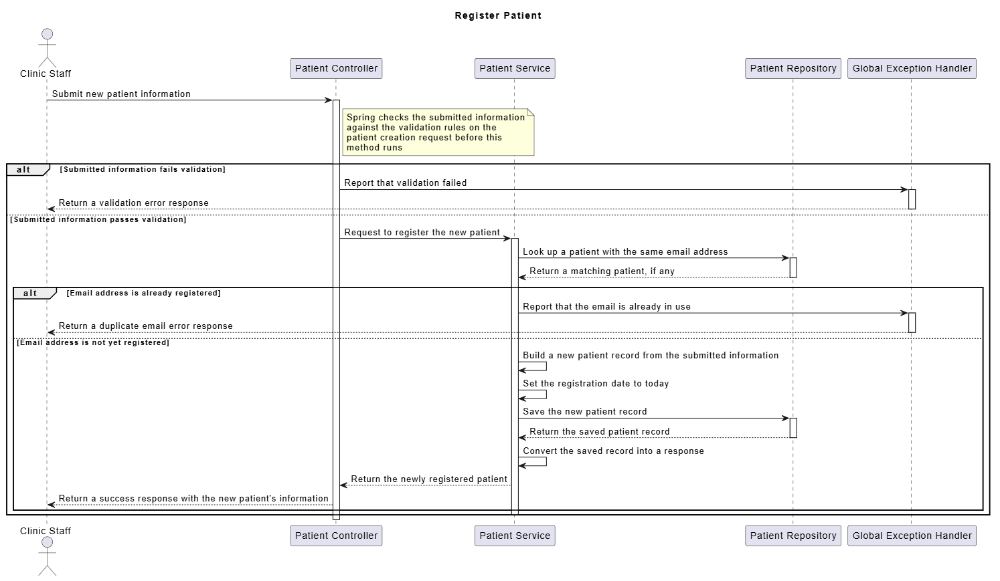
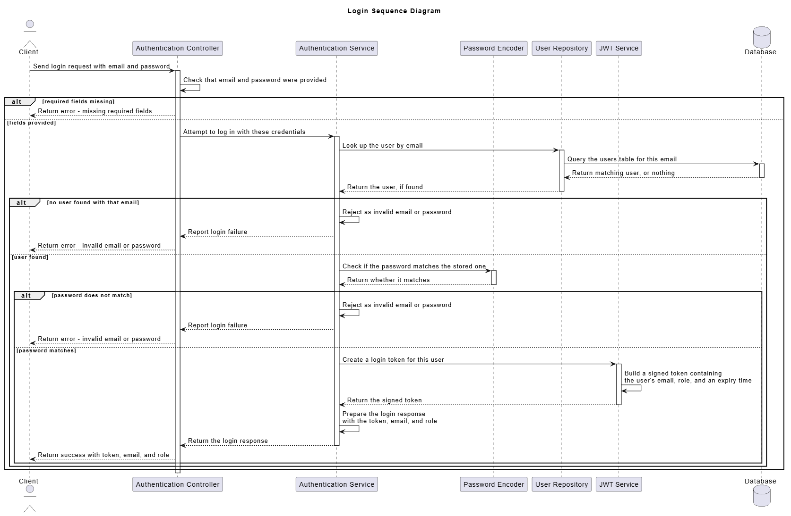
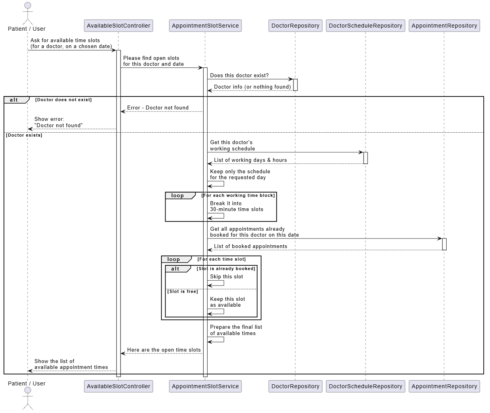
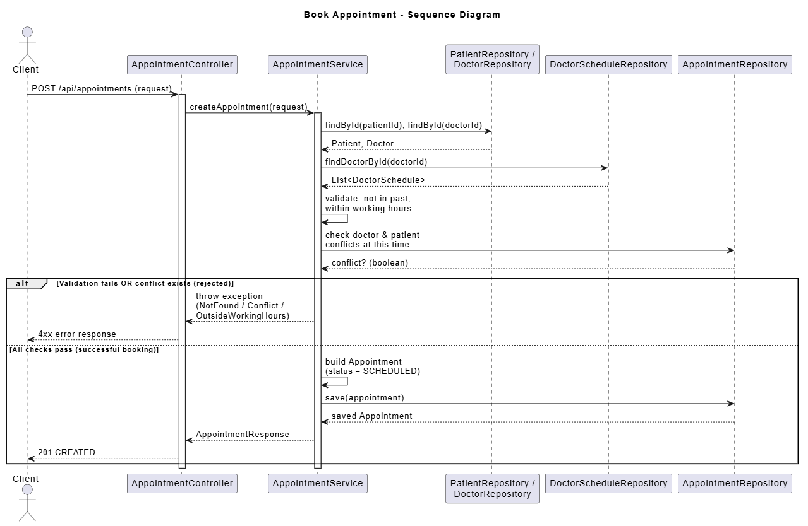
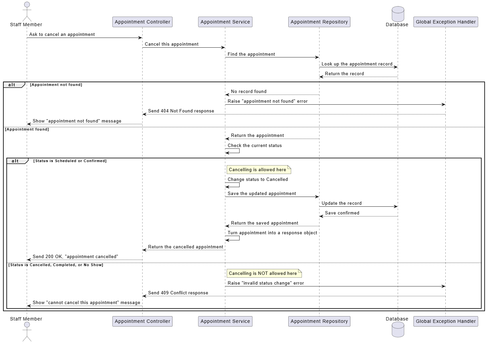
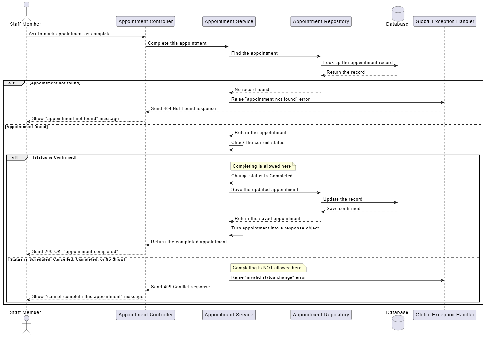
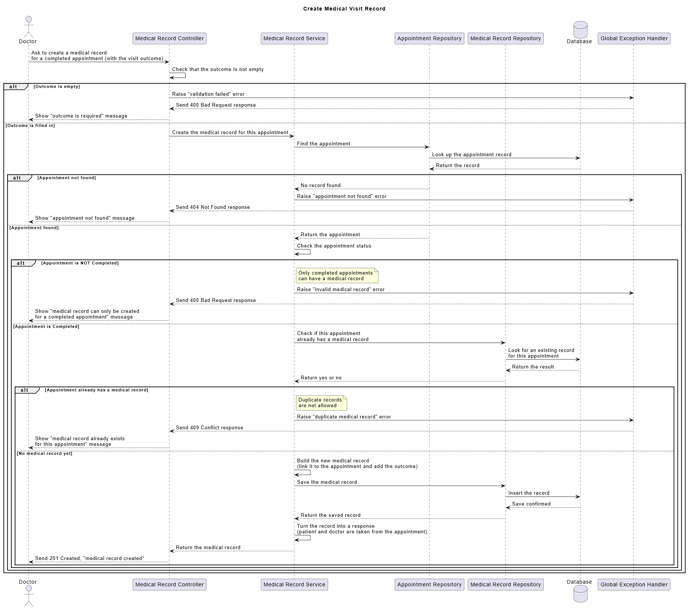
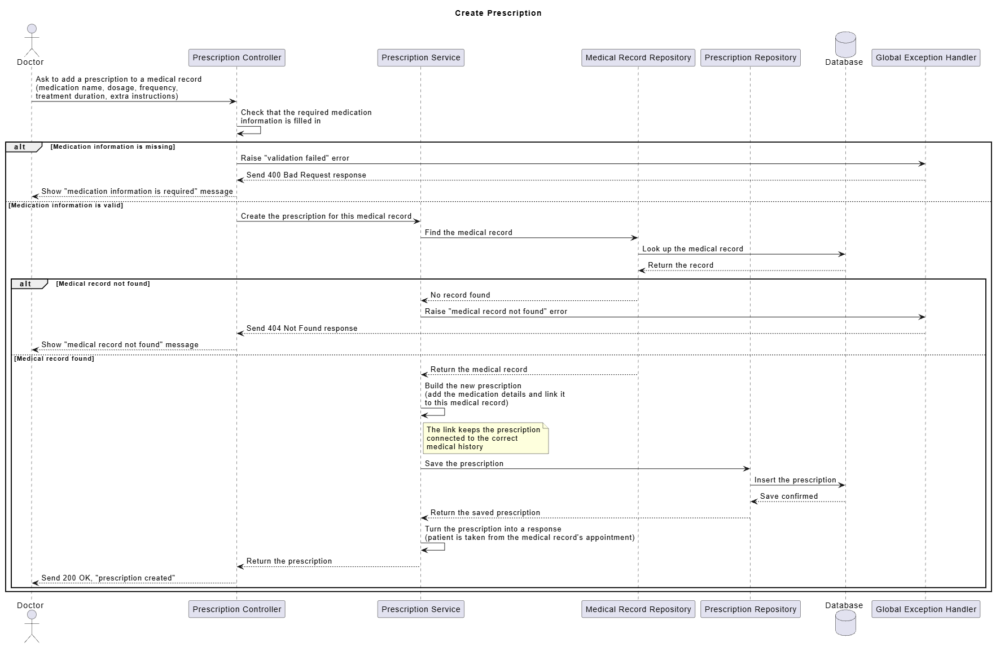
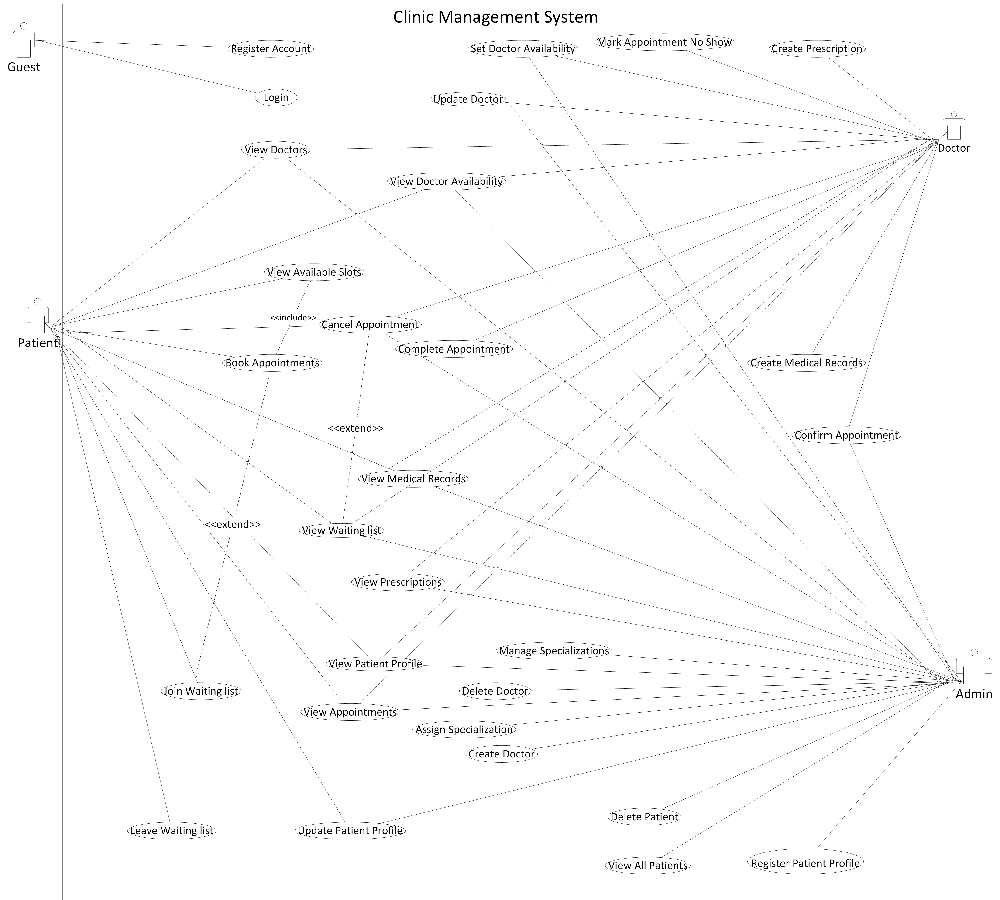

# Clinic Appointment Management System

A full-stack Clinic Appointment Management System developed
using **Angular**, **Spring Boot**, and **PostgreSQL**.

The system provides an easy way to manage doctors, patients,
appointments, medical records, and prescriptions.

The main goal of this project is to simplify clinic operations
while applying the programming and software engineering
concepts we learned throughout our computer science studies.
## Table of Contents

- [Features](#features)
- [Tech Stack](#tech-stack)
- [Getting Started](#getting-started)
- [Project Structure](#project-structure)
- [How the System Works](#how-the-system-works)
- [Authentication and Authorization](#authentication-and-authorization)
- [API Endpoints](#api-endpoints)
- [Validation and Error Handling](#validation-and-error-handling)
- [Testing with Postman](#testing-with-postman)
- [Frontend](#-frontend)
- [Diagrams](#diagrams)
- [Final Notes](#-final-notes)
- [Contact](#-contact)

## Features

- **Authentication:** Register an account and log in using JWT authentication.
- **Role-based access:** Supports `ADMIN`, `DOCTOR`, and `PATIENT` roles.
- **Patients:** Create, view, update, and delete patient information; see appointment history.
- **Doctors:** Manage doctor profiles, specializations, and appointment lists.
- **Specializations:** Add specializations and browse doctors by specialization.
- **Doctor schedules:** Set weekly working hours and view availability.
- **Available slots:** Check free appointment times for a doctor on a specific date.
- **Appointments:** Book, search, confirm, cancel, complete, and mark appointments as no-show.
- **Waiting list:** Join or leave a waiting list for a requested appointment slot.
- **Medical records:** Record visit outcomes and retrieve a patient's medical history.
- **Prescriptions:** Create prescriptions linked to medical records and retrieve them later.
- **Search and pagination:** Filter appointment/doctor results and paginate supported listings.
- **Validation and errors:** Validate input and return consistent errors for invalid operations.

## Tech Stack

| Technology | Purpose |
| --- | --- |
| Java 21 | Main programming language |
| Spring Boot 4.1.1 | Backend framework |
| Spring Web MVC | REST endpoints |
| Angular | Frontend framework |
| TypeScript | Frontend programming language |
| Spring Data JPA | Database access |
| Spring Security | Authentication and access control |
| JWT (JJWT 0.12.6) | Token-based authentication |
| PostgreSQL | Relational database |
| Flyway | Database schema migrations |
| Jakarta Validation | Request validation |
| Lombok | Reduce boilerplate code |
| Maven / Maven Wrapper | Build and dependency management |
| Postman | API testing |


## Getting Started

### Prerequisites

Install **Java 21**, **PostgreSQL**, and **Node.js with npm** to run the application.

The backend includes a Maven Wrapper, so installing Maven separately is not required.

Postman can also be used to test the REST APIs.

### 1. Get the project

Clone your repository or extract the project ZIP, then open the `ClinicAppointmentSystem` folder in your IDE or terminal.

---

### 2. Create the database

Create a PostgreSQL database named `clinic_appointment_system`:

```sql
CREATE DATABASE clinic_appointment_system;
```

The application uses Flyway migrations from `src/main/resources/db/migration/` to set up and update the database schema.

---

### 3. Configure the environment

The existing `src/main/resources/application.properties` contains:

```properties
spring.application.name=ClinicAppointmentSystem
server.port=8090
spring.datasource.url=jdbc:postgresql://localhost:5432/clinic_appointment_system
spring.datasource.username=postgres
spring.datasource.password=${DB_PASSWORD}
spring.jpa.hibernate.ddl-auto=validate
spring.jpa.show-sql=false
spring.flyway.enabled=true
```

Set `DB_PASSWORD` to your PostgreSQL password before running the application. For example:

**Windows PowerShell**

```powershell
$env:DB_PASSWORD="your_postgres_password"
.\mvnw.cmd spring-boot:run
```

**macOS / Linux**

```bash
export DB_PASSWORD="your_postgres_password"
./mvnw spring-boot:run
```

Make sure PostgreSQL is running. Database credentials and any JWT-related configuration required by your local setup should be supplied securely, not committed as real secrets.

---
### 4. Run the application

You can also run `ClinicAppointmentSystemApplication` from your IDE. Once it starts, the base URL is:

```text
http://localhost:8090
```

All routes below use this base URL.

---


### 5. Running the Frontend

The Angular frontend is located in a separate project folder named `Clinic-Frontend`.

Open a new terminal in the `Clinic-Frontend` directory.

Install the required dependencies:

```bash
npm install
```

Start the Angular development server:

```bash
npx ng serve
```
By default, the frontend runs at:

`http://localhost:4200`

---

### 6. Build and test 

```bash
# macOS / Linux
./mvnw clean test
./mvnw clean package
```

```powershell
# Windows
.\mvnw.cmd clean test
.\mvnw.cmd clean package
```
---

## Project Structure

```text
ClinicAppointmentSystem/
├── Docs/                       # UML and sequence diagram images
├── Postman/                    # Postman collection
├── src/
│   ├── main/
│   │   ├── java/com/ClinicSystem/ClinicAppointmentSystem/
│   │   │   ├── Controller/      # REST API endpoints
│   │   │   ├── DTO/             # Request and response objects
│   │   │   ├── Exception/       # Custom exceptions and global handler
│   │   │   ├── Model/           # JPA entities and enums
│   │   │   ├── Repository/      # Spring Data repositories
│   │   │   ├── Security/        # JWT filter, token service, security config
│   │   │   ├── Service/         # Business logic
│   │   │   └── ClinicAppointmentSystemApplication.java
│   │   └── resources/
│   │       ├── application.properties
│   │       └── db/migration/   # Flyway SQL migrations
│   └── test/                   # Application tests
├── pom.xml
├── mvnw
└── mvnw.cmd
```
**Frontend:** The Angular application is maintained in a separate project folder named `Clinic-Frontend`.

## How the System Works

The project follows a simple layered structure:

```text
Angular Frontend / Postman
          ↓
Spring Boot Controllers
          ↓
     Service Layer
          ↓
   Repository Layer
          ↓
      PostgreSQL
```

**Controllers** expose the endpoints. **Services** handle things like checking schedule conflicts, changing appointment statuses, and enforcing access rules. **Repositories** communicate with PostgreSQL using Spring Data JPA. **DTOs** keep request and response data separate from the database entities. **Flyway** handles database changes, while **Spring Security** and JWT protect routes that require authentication.

### Main entities

`User`, `Patient`, `Doctor`, `Specialization`, `DoctorSchedule`, `Appointment`, `WaitingListEntry`, `MedicalRecord`, and `Prescription`.

### Appointment lifecycle

Appointments can have these statuses: `SCHEDULED`, `CONFIRMED`, `CANCELLED`, `COMPLETED`, and `NO_SHOW`. The service layer checks whether each requested status change is allowed.

## Authentication and Authorization

Register using `POST /api/auth/register`, then log in using `POST /api/auth/login`. The login response includes the authentication data used to access protected endpoints. For authenticated requests, send the JWT in the header:

```http
Authorization: Bearer <your_jwt_token>
```

The application defines three roles: `ADMIN`, `DOCTOR`, and `PATIENT`. Access depends on the endpoint and the security/service rules. For example, waiting-list joining and leaving require the `PATIENT` role, while viewing a waiting list accepts `PATIENT`, `DOCTOR`, or `ADMIN`.

## API Endpoints

**Base URL:** `http://localhost:8090`  
**Content type for JSON requests:** `application/json`  
**Note:** Examples below show request bodies, not guaranteed response payloads. Use a valid token where authorization is required.

### Authentication

Account creation and login.

#### `POST /api/auth/register`

Register.

Example JSON request:

```json
{
  "email": "patient@example.com",
  "password": "StrongPassword123"
}
```



#### `POST /api/auth/login`

Login.

Example JSON request:

```json
{
  "email": "patient@example.com",
  "password": "StrongPassword123"
}
```



---

### Patient Management

Patient profiles and their appointments.

#### `POST /api/patients`

Create patient.

Example JSON request:

```json
{
  "firstName": "Sara",
  "lastName": "Ahmed",
  "email": "sara@example.com",
  "phoneNumber": "01012345678",
  "dateOfBirth": "2002-05-15",
  "gender": "FEMALE"
}
```

#### `GET /api/patients`

Get all patients.

Query parameters: `page`, `size`, `sort`.

#### `GET /api/patients/{id}`

Get by id.

#### `GET /api/patients/{patientId}/appointments`

Get patient appointments.

Query parameters: `status`.

#### `PUT /api/patients/{id}`

Update patient.

#### `DELETE /api/patients/{id}`

Delete patient.

---

### Doctor Management

Doctor profiles, filters, and assigned specializations.

#### `POST /api/doctors`

Create doctor.

Example JSON request:

```json
{
  "firstName": "Omar",
  "lastName": "Hassan",
  "email": "omar@example.com",
  "phoneNumber": "01012345678",
  "licenseNumber": "LIC-1001",
  "yearsOfExperience": 8,
  "consultationFee": 300,
  "specializationId": 1
}
```

#### `GET /api/doctors`

Get all doctors.

Query parameters: `specialization`, `name`, `page`, `size`, `sort`.

#### `GET /api/doctors/{id}`

Get doctor by id.

#### `GET /api/doctors/{doctorId}/appointments`

Get doctor appointments.

Query parameters: `status`.

#### `PUT /api/doctors/{id}`

Update doctor.

#### `PUT /api/doctors/{doctorId}/specialization/{specializationId}`

Assign specialization.

#### `DELETE /api/doctors/{id}`

Delete doctor.

---

### Specialization Management

Specialization catalog and related doctors.

#### `POST /api/specializations`

Create specialization.

Example JSON request:

```json
{
  "name": "Cardiology",
  "description": "Heart and cardiovascular care"
}
```

#### `GET /api/specializations`
Get all specializations.

#### `GET /api/specializations/{id}`
Get specialization by ID.

#### `GET /api/specializations/{id}/doctors`
Get doctors by specialization.

---

### Doctor Schedules

Weekly working hours for a doctor.

#### `POST /api/doctors/{doctorId}/availability`

Create availability.

Example JSON request:

```json
{
  "dayOfWeek": "MONDAY",
  "startTime": "09:00:00",
  "endTime": "17:00:00"
}
```

#### `GET /api/doctors/{doctorId}/availability`

Get doctor availability.

---

### Available Appointment Slots

Available times for a doctor on a chosen date.

#### `GET /api/doctors/{doctorId}/available-slots`

Get available slots.

Query parameters: `date`.



---

### Appointment Management

Booking, listing, and appointment status updates.

#### `POST /api/appointments`

Create appointment.

Example JSON request:

```json
{
  "patientId": 1,
  "doctorId": 1,
  "appointmentDate": "2026-11-10",
  "appointmentTime": "10:00:00",
  "reasonForVisit": "Regular checkup"
}
```



#### `GET /api/appointments`

Get appointments.

Query parameters: `status`, `page`, `size`, `sort`.

#### `GET /api/appointments/{id}`

Get appointments by id.

#### `PATCH /api/appointments/{id}/confirm`

Confirm appointment.

#### `PATCH /api/appointments/{id}/cancel`

Cancel appointment.



#### `PATCH /api/appointments/{id}/complete`

Complete appointment.



#### `PATCH /api/appointments/{id}/no-show`

Mark appointment as no show.

---

### Waiting List

Queue for a specific doctor, date, and time.

#### `POST /api/doctors/{doctorId}/waiting-list`

Join waiting list.

Example JSON request:

```json
{
  "patientId": 1,
  "appointmentDate": "2026-11-10",
  "appointmentTime": "10:00:00"
}
```

#### `GET /api/doctors/{doctorId}/waiting-list`

Get waiting list.

Query parameters: `date`, `time`.

#### `DELETE /api/doctors/{doctorId}/waiting-list`

Leave waiting list.

Query parameters: `patientId`, `date`, `time`.

---

### Medical Records

Medical visit notes attached to appointments.

#### `POST /api/appointments/{appointmentId}/medical-record`

Create medical record.

Example JSON request:

```json
{
  "outcome": "Patient examined and follow-up recommended."
}
```



#### `GET /api/patients/{patientId}/medical-records`

Get patient medical records.

#### `GET /api/medical-records/{id}`

Get medical record by id.

---

### Prescriptions

Medication instructions attached to medical records.

#### `POST /api/medical-records/{recordId}/prescriptions`

Create prescription.

Example JSON request:

```json
{
  "medicationName": "Example medication",
  "dosage": "One tablet",
  "frequency": "Twice daily",
  "treatmentDuration": "5 days",
  "additionalInstructions": "After meals"
}
```



#### `GET /api/patients/{patientId}/prescriptions`

Get prescriptions by patient.

#### `GET /api/medical-records/{recordId}/prescriptions`

Get prescriptions by medical record.

---

## Validation and Error Handling

The project uses Jakarta Bean Validation, custom exceptions, and `GlobalExceptionHandler` to return helpful errors instead of failing silently. Some of the cases handled include invalid request data, duplicate emails or license numbers, missing patients or doctors, schedule conflicts, unavailable appointment times, invalid appointment status changes, and unauthorized actions.

Typical HTTP responses include:

| Status | Meaning |
| --- | --- |
| `200 OK` | Successful read or update |
| `201 Created` | Resource created |
| `204 No Content` | Successful operation with no response body |
| `400 Bad Request` | Invalid input or business rule violation |
| `401 Unauthorized` | Missing or invalid authentication |
| `403 Forbidden` | User does not have access |
| `404 Not Found` | Requested resource does not exist |
| `409 Conflict` | Conflicting or duplicate data |

The exact status depends on the endpoint and exception handler.

## Testing with Postman

A Postman collection is included at:

```text
Postman/ClinicAppointmentSystem.postman_collection.json
```

Import it into Postman, point requests to `http://localhost:8090`, and start with registration and login. Use the returned JWT token for protected requests. Then create the supporting data (such as a specialization, doctor, patient, and doctor schedule) before trying to book an appointment.

A useful testing flow is: register → log in → create specialization → create doctor → set doctor availability → create patient → check available slots → book appointment → update appointment status → create medical record → create prescription.

Also test invalid inputs, duplicate records, overlapping appointments, dates outside working hours, and requests made without the required permissions.

## 🖥️ Frontend

The frontend is built using **Angular**, providing a simple and
user-friendly interface for interacting with the system.

It allows users to manage appointments, view doctors, and access
different features based on their roles.

The frontend communicates with the **Spring Boot backend**
through REST APIs, while JWT is used for authentication
and securing protected endpoints.

**Backend URL:** `http://localhost:8090`

## Diagrams


### Use Case Diagram



### Class Diagram


---
## 📝 Final Notes

- This project was developed as part of a software development course to apply and strengthen our practical programming skills.

- The system is a full-stack application using **Angular** for the frontend and **Spring Boot** for the backend.

- PostgreSQL is used for storing and managing the system's data.

- The backend follows a layered architecture to keep the code organized and maintainable.

- REST APIs handle communication between the frontend and backend.

- JWT authentication and role-based authorization are used to secure the system.

- The backend runs on **port 8090**.

- API endpoints can be tested using Postman.

- UML diagrams are included to explain the system's structure and main operations.

- This project helped us gain practical experience in full-stack development, database management, and API integration.

---

## 📧 Contact

This project was developed by:

### 👨‍💻 Developer 1
**Name:** Hamza Ahmed

- **LinkedIn:** [LinkedIn Profile](https://www.linkedin.com/in/hamza-ahmed-3a531a372/)
- **GitHub:** [GitHub Profile](https://github.com/Hamza-Galal)

### 👨‍💻 Developer 2
**Name:** Mohamed Adel

- **LinkedIn:** [LinkedIn Profile](https://www.linkedin.com/in/mohammed-adel-aa1ab93b3/)
- **GitHub:** [GitHub Profile](https://github.com/Mohamed-AdelDev)